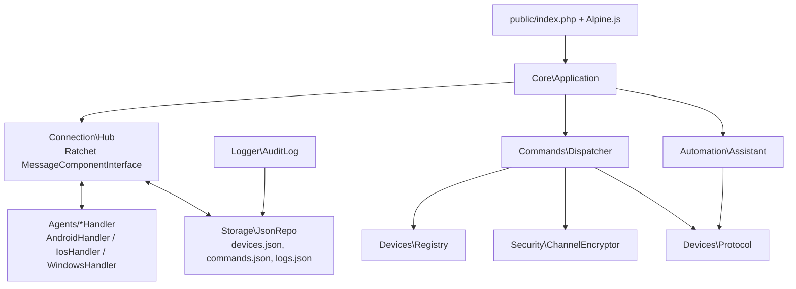

<!-- header:start -->
<div align="center">



<a href="#-quick-start"></a>

<a href="LICENSE"></a>

<a href="https://github.com/ajendras/aegis/stargazers"></a>
<a href="https://github.com/ajendras/aegis/actions/workflows/ci.yml"></a>

<a href="CONTRIBUTING.md"></a>

**Self-hosted PHP CMS and control panel for secure remote access, monitoring and AI-assisted automation on iOS, Android and Windows devices.**

[✨ Features](#-features) • [⚡ Quick start](#-quick-start) • [🧰 Usage](#-usage) • [🧩 Architecture](#-architecture) • [📍 Roadmap](#-roadmap) • [🤝 Contributing](#-contributing)

</div>
<!-- header:end -->

## ✨ Why Aegis Flow?

Remote management solutions are usually proprietary SaaS with poor privacy guarantees or complex enterprise stacks. Aegis Flow fills the gap with a lightweight, no-database, secure PHP control panel that lets developers, security researchers and IT admins remotely command and automate their own test or personal devices. It ships with strong encryption, a beautiful real-time UI and simple AI tooling for turning natural-language goals into executable command sequences.

- **Privacy-first** — per-device Libsodium keys keep every command and response encrypted; nothing leaves your infrastructure.
- **Zero-database** — pure JSON storage via `JsonRepo` makes setup trivial and portable.
- **Cross-platform** — unified `Dispatcher` + platform handlers (`AndroidHandler`, `IosHandler`, `WindowsHandler`) speak the same protocol.
- **AI-assisted automation** — `Assistant::suggest()` turns plain English into validated command sequences.

## 🎬 Demo

<p align="center"></p>

## 🚀 Features

<table>
<tr>
<td>📊 <b>Live Dashboard</b><br>Real-time device grid with status, platform, battery and last-seen via WebSocket</td>
<td>🔒 <b>E2E Encryption</b><br>Per-device Libsodium keys via `ChannelEncryptor::encryptFor()` and `decryptFrom()`</td>
<td>📡 <b>WebSocket Hub</b><br>Persistent Ratchet connections with `Hub::onOpen`, `onMessage`, `onClose`</td>
</tr>
<tr>
<td>⚡ <b>Instant Commands</b><br>Shell, screenshot, push/pull, install and diagnostics via `Dispatcher::dispatch()`</td>
<td>🧠 <b>AI Assistant</b><br>`Assistant::suggest()` turns natural language into command sequences; `expand()` validates them</td>
<td>📜 <b>Audit Log</b><br>Immutable, searchable log with `AuditLog::record()` and `query()`; one-click replay</td>
</tr>
<tr>
<td>🏷️ <b>Bulk Ops</b><br>`Dispatcher::broadcastToTag()` sends commands to groups defined in `Registry::byTag()`</td>
<td>📋 <b>Agent Protocol</b><br>`Protocol::createCommand()` and `validateResponse()` enforce schema across platforms</td>
<td>🌑 <b>Dark UI</b><br>Tailwind + Alpine.js dashboard with micro-animations, keyboard shortcuts and theme toggle</td>
</tr>
</table>

## 📦 Installation

**Requirements**

- PHP 8.2+
- Composer
- Libsodium (enabled by default in PHP 8.2)
- Ratchet WebSocket server (installed via Composer)

```bash
composer create-project aegis-flow/aegis-flow
cd aegis-flow
composer run serve
```

The WebSocket hub starts automatically on port 8081 when `php -S` is used from the CLI (see `Application::run()`). Open `http://localhost:8080` for the control panel.

## ⚡ Quick start

```php
<?php
require __DIR__ . '/vendor/autoload.php';

use AegisFlow\Core\Application;
use AegisFlow\Automation\Assistant;

$app = new Application();
$assistant = new Assistant();

// Natural-language goal → executable steps
$steps = $assistant->suggest('check battery and take screenshot');
$commands = $assistant->expand($steps);

echo "Generated " . count($commands) . " commands\n";
// → dispatch with Dispatcher::dispatch($deviceId, $type, $params)
```

Run the example agent in another terminal:

```bash
php examples/agent-simulator.php
```

It registers itself via the WebSocket hub and responds to commands.

## 🧰 Usage

### Send a platform-agnostic command

```php
use AegisFlow\Core\Application;
use AegisFlow\Commands\Dispatcher;

$app = new Application();
$registry = $app->getDashboardData()['devices'][0] ?? null; // example device

if ($registry) {
    $dispatcher = new Dispatcher(
        $app->registry, // internal property for demo only
        $app->config,
        $app->auditLog
    );
    $dispatcher->dispatch($registry['id'], 'screenshot', [
        'format' => 'png',
        'quality' => 90
    ]);
}
```

### AI-driven automation

```php
$assistant = new Assistant();
$goal = 'backup important files and notify me';
$steps = $assistant->suggest($goal);
$commands = $assistant->expand($steps);

foreach ($commands as $cmd) {
    // $dispatcher->dispatch($deviceId, $cmd['type'], $cmd['params'] ?? []);
}
```

### Bulk broadcast by tag

```php
$dispatcher = new Dispatcher($registry, $config, $auditLog);
$command = ['type' => 'notify', 'params' => ['title' => 'Maintenance', 'body' => 'Update complete']];
$success = $dispatcher->broadcastToTag('lab', $command);
echo "Sent to $success devices";
```

<details><summary>Advanced: Start the WebSocket hub and register a device</summary>

```php
// Run via CLI — Application::run() detects php_sapi_name() === 'cli'
$app = new Application();
$app->run(); // starts Ratchet IoServer on ws_port from Config
```

The `examples/agent-simulator.php` connects, sends a `register` message with `platform`, `name` and `tags`, then receives encrypted commands via `Hub::onMessage()`.

</details>

## 🔧 Configuration

Configuration lives in `config.json` (created automatically by `Config::__construct()`).

| Option                | Default                              | Description |
|-----------------------|--------------------------------------|-------------|
| `ws_port`             | 8081                                 | Port for the Ratchet WebSocket server (`Hub`) |
| `theme`               | dark                                 | Default UI theme passed to dashboard |
| `log_retention_days`  | 90                                   | Days to keep entries in `AuditLog` |
| `encryption_seed`     | random 64-hex string                 | Master seed for `Config::getDeviceKey()` derivation |
| `api_key`             | change-this-in-production-...        | Used by `AuthManager::validateToken()` |

Use `Config::get($key, $default)` and `Config::setEncryptionSeed()` to modify at runtime.

## 🧩 Architecture



Aegis Flow uses a central `Application` that bootstraps `Config`, `Registry` and `AuditLog`. The `Hub` manages persistent WebSocket connections from agents and the UI, routing messages to `Dispatcher` which selects the correct platform handler, encrypts payloads, and stores them. All state lives in JSON files; `Assistant` provides deterministic keyword-based automation without external services.

## 📁 Project structure

```text
.
├── composer.json                 # PSR-4 AegisFlow\ => src/, scripts: test/serve/start
├── public/
│   ├── index.php                 # Front controller; routes / and /api/* via Application::handleHttp()
│   ├── css/app.css               # Tailwind dark theme, device cards, micro-animations
│   └── js/app.js                 # Alpine.js + WebSocket client for live updates
├── src/
│   ├── Core/
│   │   ├── Application.php       # Bootstraps services, getDashboardData(), handleHttp(), run()
│   │   └── Config.php            # Loads config.json, get(), setEncryptionSeed(), getDeviceKey()
│   ├── Devices/
│   │   ├── Registry.php          # JSON-backed store: add(), updateStatus(), find(), all(), byTag()
│   │   └── Protocol.php          # createCommand(), validateResponse()
│   ├── Agents/
│   │   ├── AndroidHandler.php    # handle() → execute_shell, capture_screen, etc.
│   │   ├── IosHandler.php        # handle() → companion_v2 payloads
│   │   └── WindowsHandler.php    # handle() → powershell_execute, etc.
│   ├── Commands/
│   │   └── Dispatcher.php        # dispatch(), broadcastToTag(), uses platform handlers + encryption
│   ├── Automation/
│   │   └── Assistant.php         # suggest() keyword map, expand() via Protocol
│   ├── Connection/
│   │   └── Hub.php               # Ratchet onOpen/onMessage/onClose, pending command push
│   ├── Security/
│   │   ├── AuthManager.php       # issueToken(), validateToken(), requirePermission()
│   │   └── ChannelEncryptor.php  # encryptFor(), decryptFrom() using Config::getDeviceKey()
│   ├── Logger/
│   │   └── AuditLog.php          # record(), query() — append-only
│   ├── Storage/
│   │   └── JsonRepo.php          # read(), write() for devices/logs/commands
│   └── Panel/
│       └── View.php              # render() dashboard with embedded device grid
├── tests/
│   └── RegistryTest.php          # PHPUnit tests for registration, status, tags, round-trips
└── examples/
    └── agent-simulator.php       # CLI demo agent that registers and echoes mock responses
```

## 🧪 Testing

```bash
composer test
# or
vendor/bin/phpunit
```

`RegistryTest.php` covers device registration, status updates, tag filtering, and command round-trip simulation using the real `Registry`, `Protocol` and mock handlers.

## 📍 Roadmap
<!-- roadmap:start -->
- [x] **v0.1.0** — first release: Live Dashboard, E2E Encryption, Agent Protocol, Instant Commands
- [ ] Add macOS agent handler with AppleScript support
- [ ] Implement optional Redis backend for >50 devices
- [ ] Natural language command parser using local LLM (Ollama)
- [ ] WebRTC screen streaming for live view
- [ ] Mobile-friendly control panel PWA
- [ ] Exportable audit reports in PDF with signatures
- [ ] Plugin system for custom device handlers
- [ ] Rate limiting and connection throttling
- [ ] Built-in SSH fallback for Windows/Linux servers
- [ ] One-click agent installer generators (Windows .exe, Android APK)
- [ ] Integration with webhook alerts on suspicious activity
- [ ] Support for grouping devices by geolocation

> 🤖 This roadmap is worked through continuously — ideas and PRs welcome!
<!-- roadmap:end -->

## 🤝 Contributing

Contributions are welcome and appreciated! Please read [CONTRIBUTING.md](https://github.com/ajendras/aegis/blob/main/CONTRIBUTING.md) and follow our [CODE_OF_CONDUCT.md](https://github.com/ajendras/aegis/blob/main/CODE_OF_CONDUCT.md). Good-first-issue PRs are especially encouraged — check the issue tracker for starter tasks around new agent handlers or UI improvements.

## 📄 License

AGPL-3.0-only. See [LICENSE](https://github.com/ajendras/aegis/blob/main/LICENSE) for the full text.

<!-- footer:start -->
<div align="center">

### ⭐ Star history

<a href="https://star-history.com/#ajendras/aegis&Date"></a>

If **Aegis Flow** saves you time, a ⭐ helps others find it.

Made with ❤️ by [Ajendra](https://ajendra.info)


</div>
<!-- footer:end -->
